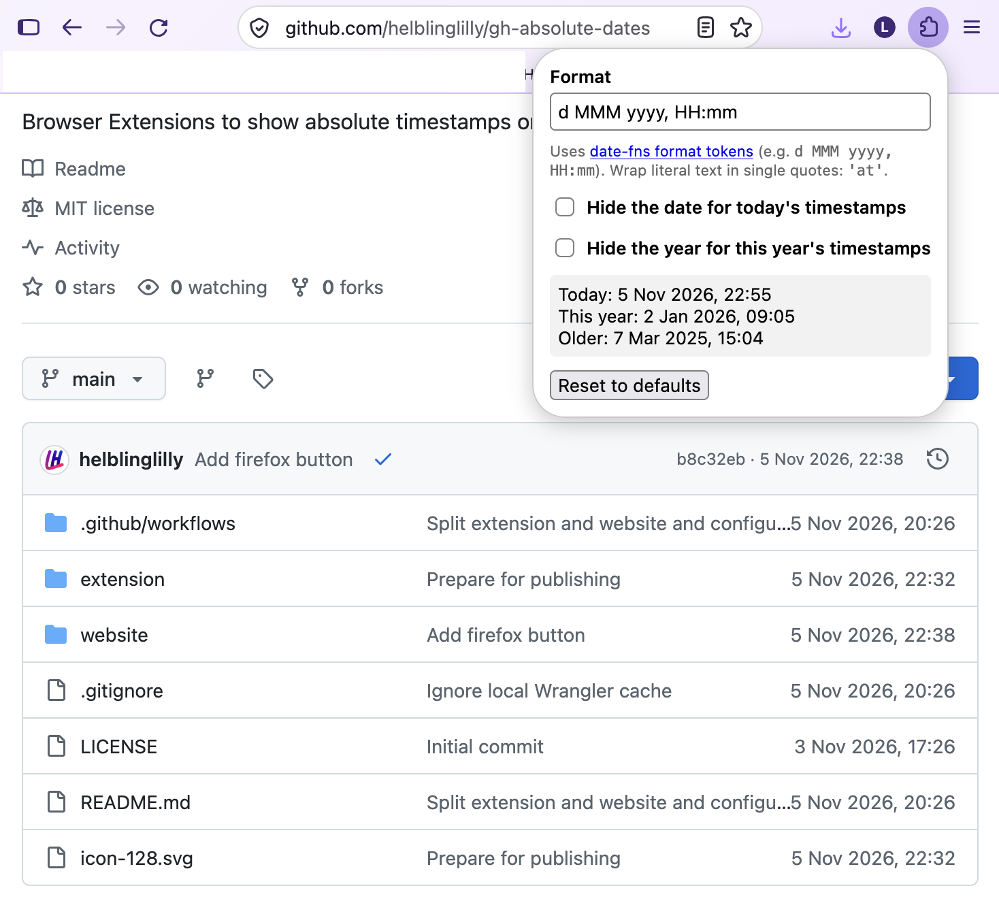

# GitHub Absolute Dates

A browser extension for Chrome and Firefox that replaces GitHub's relative
timestamps ("1 minute ago") with absolute dates ("10 Oct 2026, 22:38").

## Install

### Chrome (and Chromium browsers: Edge, Brave, ...)

Install from the
[Chrome Web Store](https://chrome.google.com/webstore/detail/emgehigipehjohffhkjchncdplggnimo).
It updates automatically.

To install manually from a release instead:

1. Download the Chrome ZIP from [GitHub Releases](https://github.com/helblinglilly/gh-absolute-dates/releases/latest)
   and **unzip it** into a folder you can keep. Chrome loads the extension from that folder.
2. Open `chrome://extensions` and turn on **Developer mode** (top right).
3. Click **Load unpacked** and select the unzipped folder.
4. Optional: pin the extension from the puzzle-piece menu to reach its settings.

To update, download the new zip, replace the folder's contents, and click the reload
arrow on the extension's card.

### Firefox

Open [gh.helbling.uk](https://gh.helbling.uk/) in Firefox, choose **Install for Firefox**,
and confirm **Add**. To update version 1.0.1, install the newer build from the same
page when it becomes available.

## Settings

Click the extension's toolbar icon:

- **Format**: a single [date-fns `format`](https://date-fns.org/docs/format) pattern.
  The default is `d MMM yyyy, HH:mm`. See the
  [format reference](https://date-fns.org/docs/format) for all tokens. Note these are
  date-fns tokens: `yyyy` for year and `d` for day (not `YYYY`/`D`). Wrap literal text in
  single quotes, e.g. `d MMM yyyy 'at' HH:mm`.
- **Hide the date for today's timestamps**: date tokens are removed from today's
  timestamps along with their neighbouring separators, so the default becomes `HH:mm`.
- **Hide the year for this year's timestamps**: year tokens are removed for the current
  year, so the default becomes `d MMM, HH:mm`. If both apply (a timestamp from today),
  hiding the date wins.
- **Show all dates in UTC**: timestamps are shown in UTC instead of your browser's
  time zone. "Today" and "this year" are then also judged in UTC. Add a literal to the
  format to make this visible, e.g. `d MMM yyyy, HH:mm 'UTC'`.

All checkboxes are off by default. Changes apply live, without reloading GitHub.

For development and release instructions, see [CONTRIBUTING.md](CONTRIBUTING.md).
